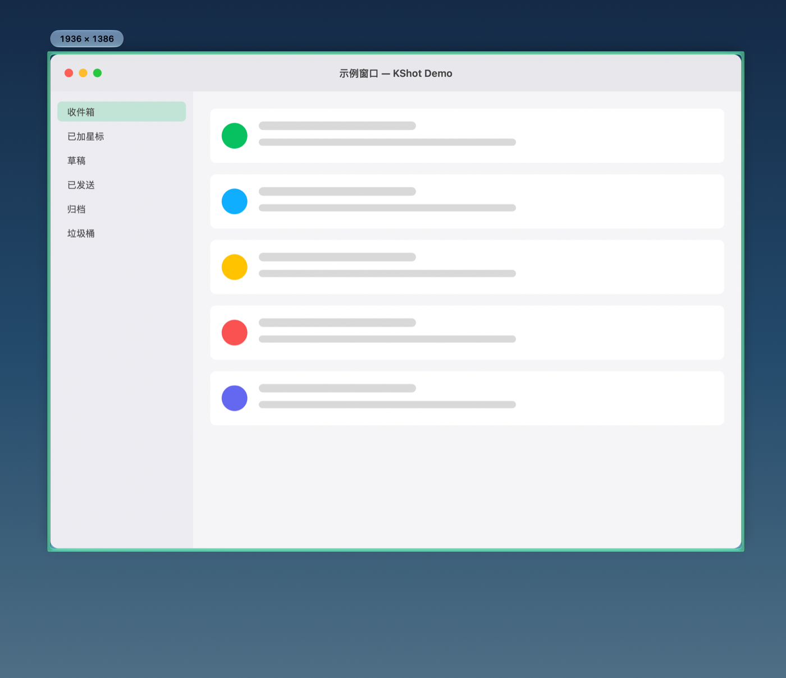
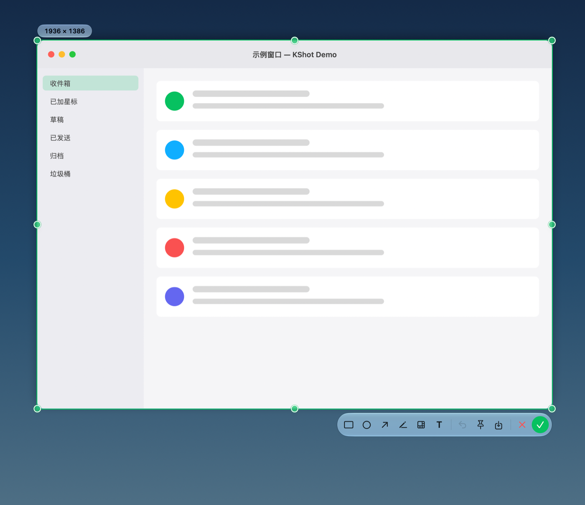
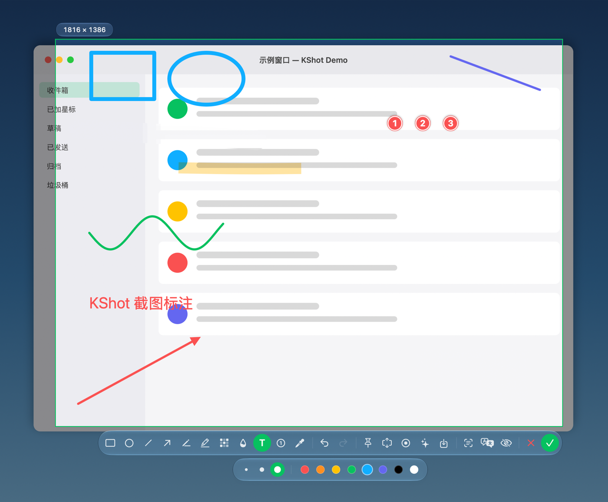
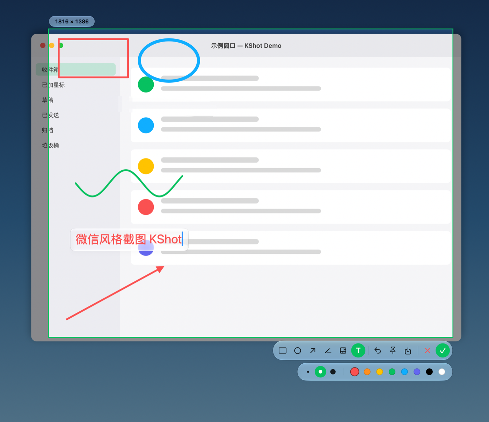
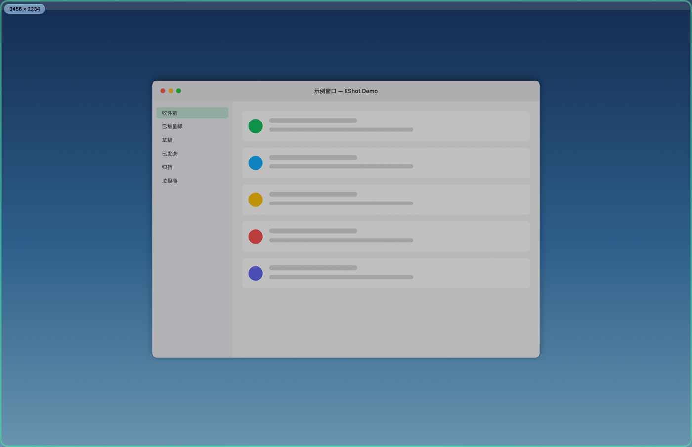
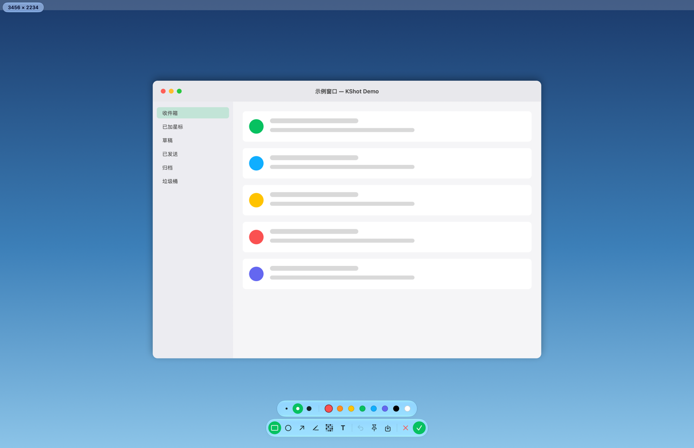
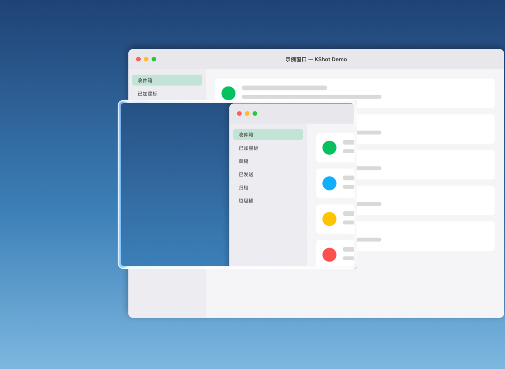
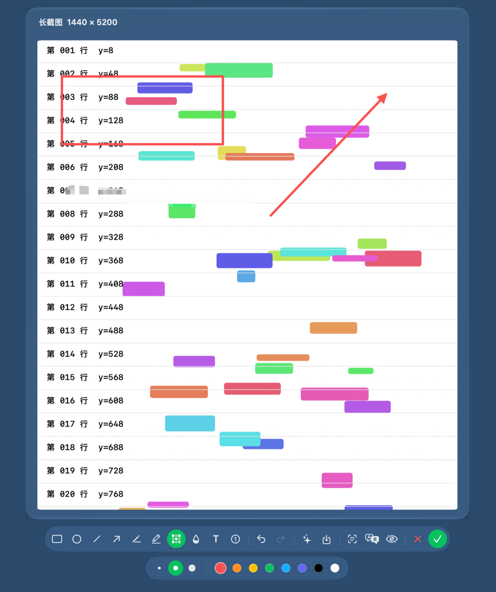
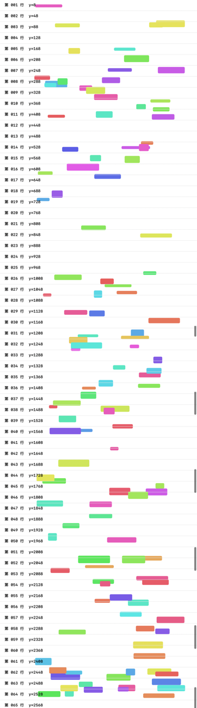
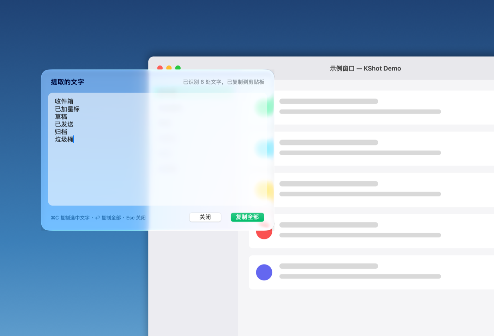

<p align="center">
  
</p>

<h1 align="center">KShot — macOS 截图工具</h1>

<p align="center">菜单栏常驻的截图小工具：全屏冻结、自动识别窗口、拖拽选区、放大镜取色、标注、美化、长截图、录屏、OCR / 二维码、自动打码、钉图。</p>

<p align="center">
  <a href="LICENSE">MIT 开源协议</a> ·
  <a href="https://kshot.org">官网</a> ·
  <a href="https://github.com/FranckStone/kshot/releases/latest">下载</a> ·
  <a href="CONTRIBUTING.md">参与贡献</a>
</p>

## 截图

界面上的浮层（工具条、粗细 / 颜色面板、尺寸标签、文字输入框、悬停边框、把手、钉住窗口）均为 macOS 26 的 Liquid Glass 液态玻璃风格，旧系统自动回退为毛玻璃。

鼠标悬停自动识别窗口，玻璃框贴合窗口圆角，左上角显示像素尺寸：



单击选中窗口，出现玻璃把手与工具条：



工具条与粗细 / 颜色面板，支持矩形、椭圆、直线、箭头、画笔、荧光笔、马赛克、模糊、文字、序号：



文字标注就地输入，输入框是会随内容伸缩的玻璃面板：



鼠标在桌面上时整屏轻微压暗，屏幕边缘出现贴合屏幕圆角的玻璃框，提示正处于截图状态：



整屏选区时工具条水平居中贴近底部：



“钉在屏幕上”把截图变成带玻璃边框的悬浮卡片，可拖动、滚轮缩放、双击关闭：



“长截图”：自己滚动、程序实时拼接，完成后在编辑窗口里继续标注（工具与截图时一致）：



拼接结果示例（对 2600pt 高的示例内容滚动拼接，与真值逐像素比对一致，缩放显示）：



“提取文字”用系统 Vision 做中英文 OCR，结果自动复制到剪贴板，窗口里可以继续编辑；“翻译”在此基础上调用系统 Translation 框架离线翻译，译文显示在下方面板：



## 功能一览

- **放大镜取色**：选好区域后点工具条上的吸管按钮打开，鼠标旁显示像素级放大镜、像素坐标与 HEX / RGB 色值；单击或按 `C` 复制 HEX，⇧ 单击或 `⇧C` 复制 RGB，可以连续取多个颜色。再点一次按钮关闭。想在框选时也显示，可在设置里打开。
- **标注可再编辑**：画完的标注可以点中后拖动、拖把手缩放 / 改端点、在选项面板改颜色和粗细、`Delete` 删除、方向键微调；双击文字可重新编辑；支持撤销 `⌘Z` / 重做 `⇧⌘Z`。
- **更多标注工具**：直线、荧光笔（正片叠底，不遮文字）、模糊、序号 ①②③（自动递增）；矩形 / 椭圆按住 `⇧` 画正方形 / 正圆，直线 / 箭头按住 `⇧` 约束到 45°。
- **截取上次区域**（`⌃⇧⌘A`）和 **延时截图**（菜单 › 延时截图 › 3 / 5 / 10 秒）。
- **美化**（`⌘B`）：渐变 / 纯色 / 透明背景、内边距、圆角、阴影，一键复制或保存。
- **窗口阴影**：设置里打开后，单击选中窗口直接完成，会输出带系统阴影、背景透明的窗口图。
- **二维码识别**：“提取文字”同时识别二维码，链接可一键打开。
- **自动打码**（`⌘E`）：OCR 找出手机号、邮箱、身份证号、银行卡号、API Key / 令牌，自动盖上马赛克，可撤销。
- **截图历史**：菜单栏 › 最近截图，可复制、钉住、再编辑、在 Finder 中显示。
- **录屏**（`⌘R` 或全局 `⌃⌘R`）：录制选区为 MP4，或导出 GIF；文件存到默认目录并复制到剪贴板。
- **钉图增强**：`⌥` 滚轮或右键调透明度、鼠标穿透、`⌥` 拖动把图片拖到其他应用、右键再编辑；菜单栏 › 钉图 可一键隐藏 / 显示 / 关闭全部。
- **设置**（菜单 › 设置… `⌘,`）：玻璃侧栏 + 分组卡片的设置窗口，分「通用 / 权限 / 保存 / 快捷键 / 历史 / 关于」六页：放大镜、快门声、窗口阴影、录屏指针、开机自启（菜单栏不再单独放开关）；屏幕录制（必需）与辅助功能（长截图自动滚动，可选）的授权状态、跳转系统设置、授权后一键重启；默认保存目录、文件名模板（`{date}` `{time}` `{w}` `{h}`，可一键插入）、PNG / JPEG / HEIC、保存免弹窗、完成时自动保存；历史保留数量与清空。
- **快捷键设置**（设置 › 快捷键）：全局快捷键（截图、截取上次区域、延时 5 秒截图、录屏、显示 / 隐藏钉图）和截图时的快捷键（完成、保存、钉图、长截图、录屏、美化、提取文字、翻译、自动打码、撤销、重做）都可以自定义；点击后按下新组合键，`⌫` 清除，单项或全部恢复默认，冲突的组合会标红提示。

## 下载与安装

从 [GitHub Releases](https://github.com/FranckStone/kshot/releases/latest) 下载最新版本。当前安装包适用于 **Apple Silicon（arm64）和 macOS 14+**。

- **DMG**：打开后，将 KShot 拖到「Applications」。
- **ZIP**：解压后，将 KShot.app 拖到「应用程序」。
- **SHA256SUMS.txt**：安装包的 SHA-256 校验值。

当前安装包使用 Apple Development 证书签名，尚未完成 Apple 公证。

从 **0.2.0** 起，菜单栏 › **检查更新…** 或设置 › **关于** 可以直接检测新版、下载并安装，完成后自动重启。默认每天检查一次，可在“关于”关闭自动检查。首次安装后，后续更新无需到 GitHub 手动下载。

## 准备新版本

同时提升 `Resources/Info.plist` 的显示版本和构建号，构建号必须递增，并添加 `docs/releases/版本号.md`。

```bash
./release.sh     # 编译、签名，生成 ZIP / DMG / appcast.xml / SHA256SUMS.txt
```

更新包使用 Sparkle Ed25519 签名。私钥保存在本机钥匙串的 `com.frank.kshot` 账户中，不进入仓库；其他构建机器需通过安全渠道迁移同一密钥。构建只需要公钥，打包发布需要私钥。

发布 GitHub Release 时，将生成目录中的 ZIP、DMG、`appcast.xml` 和 `SHA256SUMS.txt` **一起上传**，将该版本设为正式最新版。应用从 `releases/latest/download/appcast.xml` 获取版本和更新包签名；缺少 appcast 会导致更新检测失败。发布产物必须来自对应版本的源代码，上传后不要修改 ZIP 或签名源。

## 构建与运行

```bash
./run.sh          # 编译 + 打包成 build/KShot.app + 启动
./build.sh        # 只编译打包
```

运行要求 macOS 14+。构建当前源码需要包含 **macOS 27 SDK** 的 Xcode / Command Line Tools（源码使用了该 SDK 的 API），可用 `xcrun --sdk macosx --show-sdk-version` 检查。首次启动会请求 **屏幕录制** 权限，
在「系统设置 › 隐私与安全性 › 录屏与系统录音」中勾选 KShot 后重新启动即可（KShot 设置 › 权限 里可以查看状态、跳转系统设置并一键重启）。
`build.sh` 会优先用本机的 Apple Development 证书签名，这样重新编译后权限不会失效。
没有开发证书时会使用 ad-hoc 签名；普通构建不需要官方更新签名私钥。

克隆源码与运行测试：

```bash
git clone https://github.com/FranckStone/kshot.git
cd kshot
swift test
```

贡献流程与独立发布说明见 [CONTRIBUTING.md](CONTRIBUTING.md)。

## 使用

| 操作 | 效果 |
| --- | --- |
| `⌃⌘A`（或点菜单栏图标 › 截图） | 开始截图，屏幕冻结并压暗 |
| `⌃⇧⌘A` | 截取上次区域（直接选中上次完成截图的选区） |
| `⌃⌘R` | 选区后回车开始录屏；录制中再按一次停止 |
| 移动鼠标 | 自动高亮鼠标下的窗口，左上角显示像素尺寸 |
| 吸管按钮，然后单击 / `C` / `⇧C` | 打开放大镜后复制鼠标下的颜色（HEX / RGB），截图不会退出 |
| 单击 | 选中高亮的窗口 |
| 拖拽 | 自由框选 |
| 拖动选区 / 拖动 8 个把手 | 移动 / 调整选区 |
| 方向键（+⇧ 大步） | 微调选区位置；选中标注时移动标注 |
| 工具条 | 矩形、椭圆、直线、箭头、画笔、荧光笔、马赛克、模糊、文字、序号 ｜ 撤销、重做 ｜ 钉在屏幕上、长截图、录屏、美化、保存 ｜ 提取文字 / 二维码、翻译、自动打码 ｜ 取消、完成 |
| 点击已有标注 | 选中：拖动移动，拖把手缩放，选项面板改颜色 / 粗细，`Delete` 删除；双击文字重新编辑 |
| 选项面板 | 选工具后出现：三档粗细/字号 + 8 色 |
| 文字工具 | 在选区内点击输入；点击别处、Esc 或 ⌘⏎ 结束 |
| `⏎` / 双击选区 / ⌘C | 完成，图片复制到剪贴板；选中标注工具后也可双击确认，双击文字仍为编辑，取色模式下仍为复制颜色 |
| `⌘S` | 保存为 PNG |
| `⌘P` | 钉在屏幕上（悬浮图片：拖动移动、滚轮缩放、双击或 Esc 关闭、右键菜单） |
| `⌘K` | 长截图（滚动截图）：你用触控板或滚轮在选区内正常向下滚动，程序持续抓帧并实时拼接，红色边框标明捕获范围，面板里实时展示完整的已拼接长图（每次成功拼接即刷新）；往回滚不会重复，滚太快会提示往回一点。处理来不及时只保留最新帧，完成、取消及模式切换不会同步等待拼接队列。面板上的“自动滚动”可选（需要“辅助功能”权限），画面持续不变或捕获停顿时暂停，保留当前截图，可继续滚动或重试。回车完成后进入图片编辑窗口，可继续标注、提取文字、翻译，再复制或保存 |
| `⌘T` | 提取文字：对选区做中英文 OCR 并识别二维码，结果自动复制到剪贴板并弹出可编辑的结果窗口（二维码是链接时可直接打开） |
| `⌘L` | 翻译：识别选区文字后用系统翻译译成所选语言（中文译英、其他译中，可在结果窗口切换目标语言；macOS 15+，首次需按系统提示下载语言包） |
| `⌘Z` / `⇧⌘Z` | 撤销 / 重做 |
| `⌘B` | 美化（背景、内边距、圆角、阴影） |
| `⌘E` | 自动打码 |
| `⌘R` | 录制选区（MP4 / GIF） |
| 右键 | 有选区时回到窗口识别状态；无选区时退出 |
| `Esc` | 取消选中的标注；没有选中时退出截图 |

> 以上是默认快捷键，都可以在「设置 › 快捷键」里修改。如果其他应用占用了某个全局快捷键，注册会失败（会标红提示），换一个组合即可。

> 菜单栏图标动画：悬停时准星转一圈；截图完成（复制 / 保存）时像快门一样“咔嚓”一下；长截图进行中四角呼吸、准星慢转；录屏中中间变为闪烁的圆点。系统开启“减少动态效果”时只保留静态状态。

## 调试参数

```bash
open build/KShot.app --args --preferences   # 启动后打开设置，验证正式打包后的系统控件样式
open build/KShot.app --args --shoot      # 启动后立即截图
open build/KShot.app --args --shoot --selftest   # 自动跑完整交互脚本，截图存到 ~/Library/Logs/KShot-selftest/
open build/KShot.app --args --shoot --dump       # 每秒把遮罩渲染到 ~/Library/Logs/KShot-overlay.png
open build/KShot.app --args --shoot --demo --selftest   # 用绘制的示例桌面代替真实抓屏，生成不含隐私的演示截图
open build/KShot.app --args --shoot --demo --selftest --pause-at 18   # 停在第 18 步并用 ScreenCaptureKit 抓一张真实合成的屏幕（含玻璃效果）
open build/KShot.app --args --shoot --demo --selftest --pin-test      # 最后一步改为“钉住”并抓屏
open build/KShot.app --args --shoot --demo --selftest --ocr-test      # 最后一步改为“提取文字”并抓屏
open build/KShot.app --args --shoot --demo --selftest --translate-test   # 最后一步改为“翻译”并抓屏
open build/KShot.app --args --longshot-demo      # 弹一个可滚动的示例窗口并对它跑完整长截图流程（自动滚动），结果存到 ~/Library/Logs/KShot-selftest/longshot.png
open build/KShot.app --args --longshot-demo --manual   # 同上，但由示例窗口模拟人手滚动（步长不一、会往回滚），验证手动模式
open build/KShot.app --args --stitch-test        # 用合成长图验证拼接算法的像素精度
open build/KShot.app --args --icon-demo          # 放慢 6 倍依次播放菜单栏图标的各段动画
open build/KShot.app --args --redact-test        # 合成含敏感信息与二维码的图片，验证自动打码与二维码识别
open build/KShot.app --args --beautify-test      # 美化：输出渐变 / 透明背景两种结果与窗口截图
open build/KShot.app --args --editor-test        # 图片编辑窗口：新工具、选中拖动、撤销重做
open build/KShot.app --args --editor-image /path/to/long.png   # 用真实长图验证编辑器顶部、中部、底部及回滚后的显示，输出到自测日志目录
open build/KShot.app --args --prefs-test         # 快捷键存取 / 匹配自测 + 设置窗口各页截图（真实窗口抓图，含玻璃效果；加 --fake-no-permission 看未授权状态）
open build/KShot.app --args --history-test       # 截图历史与菜单
open build/KShot.app --args --gif-test           # 用合成帧写 MP4（与录屏同参数）再转 GIF
open build/KShot.app --args --record-test x,y,w,h [--gif]   # 录制主屏指定区域 3 秒（需要屏幕未锁定）
open build/KShot.app --args --shadow-test        # 带阴影的单窗口截图（需要屏幕未锁定）
open build/KShot.app --args --longshot x,y,w,h   # 直接对主屏指定区域（pt，左上原点）启动长截图
```

安装到“应用程序”并开机自启：`./install.sh`（首次从 /Applications 启动时自动注册登录项，可在「设置 › 通用」里关闭）。

日志：`~/Library/Logs/KShot.log`

## 代码结构

- `AppDelegate.swift` 菜单栏图标、全局快捷键、权限
- `HotKey.swift` Carbon 全局快捷键封装
- `ScreenCapturer.swift` ScreenCaptureKit 抓取每块屏幕
- `WindowFinder.swift` 屏幕上窗口列表，用于悬停识别
- `CaptureSession.swift` 一次截图会话，管理多屏遮罩与收尾
- `OverlayWindow.swift` / `OverlayView.swift` 遮罩窗口与全部交互（选区、把手、标注、键鼠）
- `ToolbarView.swift` 工具条与粗细/颜色面板
- `TextEditorView.swift` 文字标注就地编辑器
- `Annotations.swift` 标注模型、渲染，以及两种画布共用的 `AnnotationLayer`（选中、拖动、缩放、撤销 / 重做）
- `Loupe.swift` 放大镜与取色
- `Settings.swift` / `PreferencesWindow.swift` 偏好设置与快捷键录制（设置窗口用 SwiftUI）
- `History.swift` 截图历史与“最近截图”菜单
- `BeautifyWindow.swift` 美化
- `WindowShadow.swift` 带阴影的单窗口截图
- `Redactor.swift` 自动打码（OCR + 规则）
- `ScreenRecorder.swift` 区域录屏（SCStream → AVAssetWriter）与 GIF 导出
- `Toast.swift` 玻璃提示条
- `FeatureTests.swift` 调试参数触发的功能自测
- `Exporter.swift` 裁剪合成、剪贴板、保存
- `PinWindow.swift` 钉在屏幕上的悬浮图片窗口
- `TextRecognizer.swift` / `OCRResultWindow.swift` 文字识别与结果窗口
- `Translator.swift` 基于系统 Translation 框架的翻译器（通过隐藏的 SwiftUI 宿主视图驱动）
- `LongScreenshot.swift` / `RegionStream.swift` / `ImageStitcher.swift` / `VisionOffsetEstimator.swift` 长截图：SCStream 60fps 区域捕获、实时预览面板、可选自动滚动；帧间位移用 Vision 平移配准做 5 横带多数投票（移植自 [ScrollSnap](https://github.com/Brkgng/ScrollSnap)，MIT），再用行签名精修到整像素，自动识别固定顶栏/底栏，支持往回滚
- `ImageEditorWindow.swift` 图片编辑窗口（长截图完成后的标注画布，复用工具条与标注渲染）
- `MenuBarIcon.swift` 菜单栏模板图标
- `DemoScene.swift` 演示模式的示例桌面
- `tools/make-icon.swift` App 图标生成脚本（含多种备选风格）

## 致谢

- 长截图的帧间位移估计（Vision 平移配准 + 横带多数投票）移植自 [ScrollSnap](https://github.com/Brkgng/ScrollSnap)（MIT License）。
- 应用内更新使用 [Sparkle](https://github.com/sparkle-project/Sparkle)。完整第三方声明见 [THIRD_PARTY_NOTICES.md](THIRD_PARTY_NOTICES.md)。

## 开源协议

KShot 使用 [MIT License](LICENSE)，允许使用、修改和再分发，包括商业用途；分发时请保留许可证及第三方版权声明。
